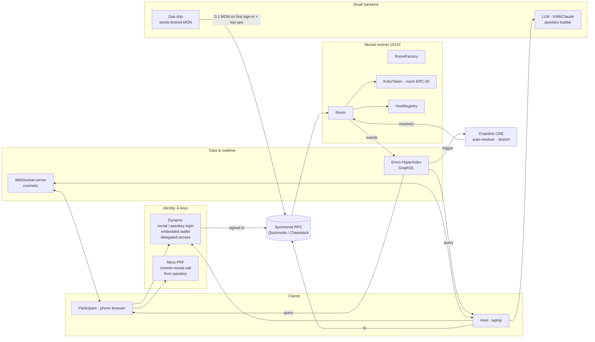
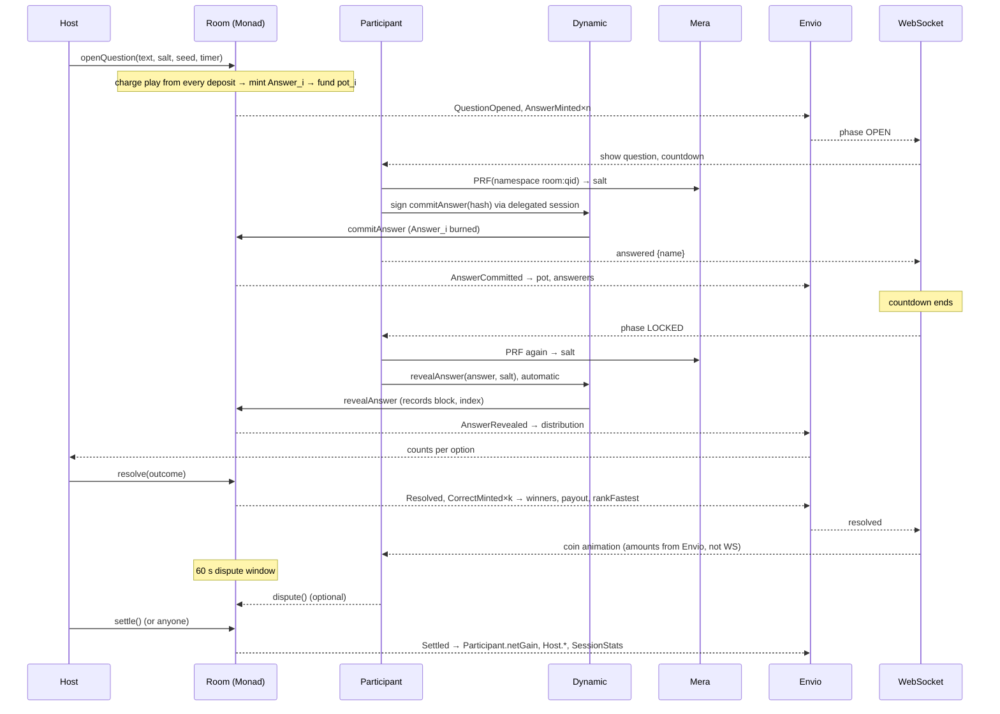

# Kokonad — Architecture & Sponsor Integrations

Companion to `PRD.md`. This document answers one question: **which component talks to which, and where each sponsor technology is used.** Principle: the chain is the source of truth for money, ordering, and results; everything else exists to make the experience feel instant.

---

## 1. Big picture



Responsibility boundaries:

| Component | May decide | May never decide |
|---|---|---|
| `Room` contract | who wins, how much, fastest order, question status | presentation, visual timer |
| Envio | what screens display (feed, leaderboard, stats) | anything that changes state |
| WebSocket | when animations fire, synced countdown | money, ordering, results |
| Dynamic | who owns a wallet, tx signatures | answer contents |
| Mera | the salt that makes a commit unguessable | anything beyond key derivation |
| Gas drip | that a new wallet gets gas once | anything else |
| LLM | suggested question text | the final question (host decides) |
| CRE | outcomes for markets with a public data source | outcomes of room markets (host decides) |

---

## 2. Accounts & gas — what a participant never sees

A participant signs in with Google or a passkey and plays. Behind that, four things must happen before the first question, silently, in the lobby:

```
sign-in (Dynamic)      → embedded wallet exists (MPC key: part on device, part with Dynamic)
gas drip (backend)     → 0.1 testnet MON sent to the new address (~25 tx: join, deposit, 10 × commit+reveal, claims)
deposit (Room)         → sponsored: 20 coins credited from the host's budget on join ("Grab 20 coins"); pooled: participant deposits their own ("Put in 20 coins")
delegation (Dynamic)   → one approval: the app may sign tx to this Room until the room closes
```

The lobby shows "Setting up your account…" until all four are done. If any fails, the participant sees a retry, not a broken game.

### Why each piece exists
- **Embedded wallet, not an installed wallet.** Participants have no wallet and won't install one for a 30-minute game. To the contract they're a normal EVM address; to themselves they're "Rafi".
- **Coins are deposits, not a faucet.** Sponsored: the host deposits a budget (starting deposit × expected people + seeds) and `join` credits each participant. Pooled: each participant deposits their own. Each opened question charges one play from every deposit into that question's pot; answering burns the play, sitting out forfeits it (PRD §5A). On testnet `KokoToken` is mintable by anyone to simulate having a stablecoin.
- **Gas drip, not a faucet contract.** The pot token is mock, but gas on testnet is real MON, and a new wallet has zero. A contract can't hand out MON for `join()` because `join()` itself needs gas. So a 30-line Node service (viem) does it: receives an address after sign-in, checks it hasn't been dripped, sends 0.1 MON from the operator wallet, records it. Rate-limited per address and per room. Before each question opens, the backend tops up any participant below 0.02 MON so nobody is stuck at question 8. The operator wallet is funded once from the Monad testnet faucet; 10 people × 2 sessions needs < 3 MON. If Dynamic offers gas sponsorship (paymaster) on 10143, use it instead and keep the drip as fallback.
- **Delegated access, not a popup per tap.** `commitAnswer` and `revealAnswer` are transactions. A dialog on each would break a 30-second timer. The participant approves once in the lobby a delegation scoped to `{ target: Room, functions: [commitAnswer, revealAnswer, claim, dispute], expiry: room.closeAt }`. After that, tap = send.
- **Host.** Holds the seed and sets results. May use an embedded wallet or an external one (MetaMask/Rabby via wagmi). For the demo the operator hosts with an external wallet for full control.

### Fallback if delegated access isn't available on 10143 (test on day 1–2)
Own session key: at `join`, the embedded wallet signs one EIP-712 message registering a temporary key (`registerSessionKey(key, expiry)`); the temporary key lives in browser memory and signs answers. `Room` accepts calls from either the participant address or its registered session key. One extra day of work; Dynamic remains the account layer.

---

## 3. Dynamic — login, wallet, signing

**Bounty:** Best Use of Dynamic $5,000. Their rubric rewards combining primitives; we use three: embedded wallets, delegated access, external wallet connection (host).

| Point | Dynamic primitive | Why |
|---|---|---|
| Participant join | Google / passkey login → embedded MPC wallet | no seed phrase, no install |
| `commitAnswer`, `revealAnswer`, `claim`, `dispute` | delegated access session, scoped to the Room, created once in the lobby | no popups during a question |
| Auto-reveal at LOCKED | delegated access, triggered by the client | reveal must happen without the participant doing anything |
| Host | embedded or external wallet | hosts hold the seed; some want their own wallet |

Note: delegated access in production needs an enterprise plan; the sandbox is enough for the hackathon demo. Verify on day 1 that sessions can be scoped per contract and created on chain 10143.

---

## 4. Mera — commit-reveal salt from a passkey

**Bounty:** Mera: One Passkey, Many Keys $2,500. Requires a non-wallet use of PRF-derived key material, at least one namespace, a live cross-device demo, and no secrets persisted to disk or server.

**Problem solved:** commit-reveal needs a salt per answer. In localStorage, a participant who switches phones or loses the tab can't reveal and is counted as not answering. On a server, the server could read answers before reveal and the "sealed" claim would be false.

**Solution:** derive the salt deterministically from the passkey.
```
salt   = PRF(passkey, namespace = "kokonad:" + roomAddress + ":" + questionId)
commit = keccak256(answer, salt)
```
- One namespace per question → salts can't be correlated across questions.
- Reveal from another device: the same passkey yields the same salt. This is the cross-device demo the bounty asks for: commit on the phone, reveal on a laptop.
- Nothing is stored anywhere; the salt is recomputed when needed.

**Second namespace (optional, "many keys"):** an encryption key for a private note the participant writes with their guess, decrypted and shown after reveal. Only if time allows.

**Coexistence with Dynamic:** Mera isn't a wallet here, only a client-side key-derivation function; Dynamic stays the wallet. Test on day 1–2: two WebAuthn libraries on one page, passkey prompt collisions, PRF support on the testers' Chrome Android / Safari iOS. **If it fails:** salt in encrypted localStorage + "don't switch phones during the session" warning; Mera dropped; third bounty moves to CRE.

**Participants without a passkey (Google only):** same fallback. Mera is the demonstrated "safer path", not a prerequisite to play.

---

## 5. Envio — everything the screens read

**Bounty:** Best Use of Envio $1,000. Rubric: derived/aggregated entities, not a raw event indexer; sensible schema; live.

**Indexed events** (from `Room`): `RoomCreated, Joined, Left, Deposited, QuestionCommitted, QuestionOpened, AnswerMinted, AnswerBurned, AnswerRevealed, CorrectMinted, Resolved, Disputed, Voided, Settled, Claimed`; from `HostRegistry`: `HostStatsUpdated`.

**Schema (`schema.graphql`)** — derived entities that set this apart from a plain indexer:
```graphql
type Room @entity { id: ID! code: String! host: Host! createdAt: BigInt! closedAt: BigInt participants: [Participant!]! @derivedFrom(field:"room") questions: [Question!]! @derivedFrom(field:"room") totalPot: BigInt! txCount: Int! }
type Question @entity { id: ID! room: Room! index: Int! status: String! template: String! rule: String! hostSeed: BigInt! playPrice: BigInt! charged: Int! pot: BigInt! answerers: Int! revealed: Int! winners: Int! disputes: Int! outcome: String openedAt: BigInt! resolvedAt: BigInt answers: [Answer!]! @derivedFrom(field:"question") }
type Answer @entity { id: ID! question: Question! participant: Participant! committedAt: BigInt! revealedAt: BigInt revealBlock: BigInt revealIndex: Int answer: String isWinner: Boolean! payout: BigInt! rankFastest: Int }
type Participant @entity { id: ID! room: Room! address: Bytes! displayName: String! joinedAt: BigInt! leftAt: BigInt deposited: BigInt! charged: BigInt! won: BigInt! netGain: BigInt! correct: Int! answered: Int! satOut: Int! biggestWin: BigInt! }
type Host @entity { id: ID! address: Bytes! sessions: Int! questionsResolved: Int! questionsVoidedByDispute: Int! totalPotDistributed: BigInt! }
type SessionStats @entity { id: ID! room: Room! txCount: Int! avgRevealLagBlocks: Float! potMoved: BigInt! boldest: Participant sharpest: Participant unluckiest: Participant }
```
`Participant.netGain = won + refunded − deposited`, `Host.*`, and `SessionStats.*` are computed in handlers on `Settled` / `Left` / room close. `SessionStats` also feeds the podium titles and the recap.

**Consumers:** participant screen (leaderboard, history), host screen (distribution after reveal, stats), README (session numbers come from this query, not hand counts).

**Deploy:** Envio Cloud, network 10143. Set `start_block` to the contract deploy block (the testnet has re-genesised before).

---

## 6. WebSocket — cosmetics that make it feel instant

Not a sponsor; adopted because it's right for UX.

| Sent over WS | Why not from the chain |
|---|---|
| `countdown` every second, single time source | every screen must show the same number |
| `answered {name}` when a client sends the commit tx (before confirmation) | feed feels immediate; Envio catches up 1–2 s later and corrects if the tx failed |
| `phase {OPEN/LOCKED/REVEAL/RESOLVED}` | transitions animate in sync |
| `resolved {outcome}` | coin animation starts before Envio finishes indexing |

Hard rules: WS never carries answer contents before reveal, never carries fastest-order, and clients never display money figures from WS. If WS is down, clients poll Envio every 2 s.

Implementation: one Node process (Socket.IO or ws), in-memory per room, no database. The server only listens to chain events (Envio subscription or viem `watchContractEvent`) and rebroadcasts.

---

## 7. LLM — question builder for hosts

**Bounty (optional):** KIMI $3,000 credits; requires KIMI "meaningfully driving a core feature" + a blog post. This feature qualifies: without it hosts write every question by hand.

```
host pastes free text (schedule, match list, topic)
  └─ prompt: produce 8–12 questions; each {text, template, options|null, rule, timerSec, suggestedSeed, suggestedBuyIn}
  └─ strict JSON, validated server-side (zod)
  └─ host edits in the UI → "Seal all" → commitQuestions()
```
The LLM never touches the chain and never knows outcomes. Model is swappable via one env var. The KIMI blog post is written in week 4 only if time allows.

---

## 8. Chainlink CRE — auto-resolver (stretch)

**Bounty:** Best workflow with CRE $3,000. CLI simulation is sufficient.

One workflow, one market type: score guessing for matches with a public API.
```
trigger : cron every 60 s, or QuestionLocked event with externalResolver flag
fetch   : GET score-api/{matchId}
compute : normalize score → bytes32 outcome (same format as EXACT/NEAREST)
write   : Room.resolve(questionId, outcome)   ← Room allows the CRE address as resolver for flagged questions
```
The dispute window still applies. This is also the proof of roadmap step 2 (hosts who aren't watching).

---

## 9. RPC & infra

- RPC: Quicknode or Chainstack (free for Metropolis participants), never public endpoints: 10 people fire tx in the same 3 seconds.
- Tenderly Pro (free for participants): simulate `settle` with 20+ winners before final deploy.
- Deploy: Foundry script; addresses written to `deployments/10143.json`, read by the frontend and the Envio config from that one file.

---

## 10. One question across all components



---

## 11. Repo structure

```
kokonad/
  CLAUDE.md             conventions for Claude Code
  README.md             for judges: what, why Monad (numbers), addresses, AI disclosure, MIT
  contracts/            Foundry: KokoToken, RoomFactory, Room, HostRegistry, test/, script/
  indexer/              Envio: config.yaml, schema.graphql, src/handlers.ts
  realtime/             Node WS server
  backend/              gas drip + LLM question builder (one small service)
  web/                  Next.js: app/(participant) app/host lib/dynamic lib/mera lib/envio lib/ws
  cre/                  score-guessing workflow (stretch)
  deployments/10143.json
  docs/                 PRD.md, ARCHITECTURE.md, mockup-v2.html, wireframes.html, reference images
```

---

## 12. Integration order (so not everything is open at once)

1. Day 1–2: Dynamic embedded + delegated on 10143, and Mera PRF on the same page. The only experiment that can change the bounty plan. Also: gas drip service (30 lines) and a Monad faucet claim.
2. Week 1: contracts + frontend with mock data. No Envio/WS yet.
3. Week 2: Envio (screens start reading the chain), then WS (screens start feeling instant). This order matters: WS without Envio tempts you to treat WS as truth.
4. Week 3: LLM builder, polish, CRE if time.
5. Week 4: no new integrations.

## 13. Claims allowed in the README (and not)

Allowed: "questions are sealed before they open", "no one can see answers before time is up", "fastest order is decided by Monad blocks, not our server", "the pot is split by the contract, not the organizers", "salts never leave the device" (Mera path).

Not allowed: "fully cheat-proof" (the host still sets the result; the sanction is social), "millisecond precision" (fair-by-block), "serverless" (there is a WS server, a drip, and an LLM call; none of them touch money).
